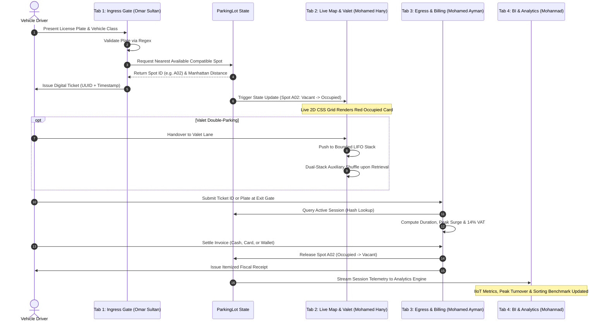

<div align="center">

# 🅿️ ParkFlow: Intelligent Multi-Tier Smart Parking Management System
### *An Industrial IoT-Driven Spatial Allocation, Algorithmic Valet Orchestration, and Business Intelligence Platform*

**Samsung Innovation Campus (SIC) — Coding & Programming Track (Cohort 8)**  
*Final Capstone Applied Graduation Project • Comprehensive Mastery Across Topics 1 to 9*

---

[](https://www.python.org/)
[](https://streamlit.io/)
[](https://pandas.pydata.org/)
[-1428A0.svg?style=for-the-badge&logo=samsung&logoColor=white)](https://www.samsung.com/)
[](#-modular-technical-deep-dive)
[](#license)

</div>

---

## 📑 Executive Table of Contents
1. [Executive Summary & Project Vision](#-executive-summary--project-vision)
2. [Engineering Division & Core Team Leadership](#-engineering-division--core-team-leadership)
3. [End-to-End Operational Lifecycle](#-end-to-end-operational-lifecycle)
4. [Modular Technical Deep Dive](#-modular-technical-deep-dive)
   - [Tab 1: Ingress Telemetry & Greedy Spot Allocation (Omar Sultan)](#tab-1-ingress-telemetry--greedy-spot-allocation-omar-sultan)
   - [Tab 2: Live Multi-Floor Grid & Valet Stack Shuffle (Mohamed Hany)](#tab-2-live-multi-floor-grid--valet-stack-shuffle-mohamed-hany)
   - [Tab 3: Egress Checkout, Dynamic Billing & Payment Gateway (Mohamed Ayman)](#tab-3-egress-checkout-dynamic-billing--payment-gateway-mohamed-ayman)
   - [Tab 4: Executive BI Analytics & Algorithm Benchmarking Lab (Mohannad)](#tab-4-executive-bi-analytics--algorithm-benchmarking-lab-mohannad)
5. [Handcrafted Data Structures & Algorithmic Rigor](#-handcrafted-data-structures--algorithmic-rigor)
6. [Mathematical Formulations & Business Logic](#-mathematical-formulations--business-logic)
7. [Industrial IoT Data Pipeline (ETL)](#-industrial-iot-data-pipeline-etl)
8. [Project Directory Blueprint](#-project-directory-blueprint)
9. [Installation & Deployment Guide](#-installation--deployment-guide)
10. [Quality Assurance & Automated Test Suite](#-quality-assurance--automated-test-suite)
11. [Academic Acknowledgments & Citation](#-academic-acknowledgments--citation)

---

## 🏢 Executive Summary & Project Vision

Urban centers and smart infrastructure environments face severe logistical bottlenecks due to inefficient spatial parking allocation, manual ticketing latency, lack of visibility into multi-floor occupancy, and clumsy valet storage logistics. 

Developed under the auspices of the **Samsung Innovation Campus (SIC 8)** capstone initiative, **ParkFlow** is an enterprise-grade, software-driven Smart Parking Management System that reconciles hardware-inspired Industrial IoT (IIoT) telemetry with advanced computational intelligence.

Rather than relying on black-box external utilities, ParkFlow implements foundational computing concepts from first principles across **Topics 1 to 9** of the SIC **Coding & Programming Track** curriculum:
- **Topics 1, 2 & 3 (Object-Oriented Architecture & Domain Modeling):** Encapsulation, inheritance, polymorphism, and defensive validation (`models/vehicle.py`, `models/parking_spot.py`, `models/parking_lot.py`).
- **Topics 4 & 5 (Linear & Non-Linear Custom Data Structures):** Handcrafted bounded LIFO Stacks with overflow/underflow protection, dual-stack auxiliary shuffle algorithms (`algorithms/stack.py`), and a custom Hash Table featuring rolling polynomial hashing and dynamic resizing (`algorithms/hash_table.py`).
- **Topics 6 & 7 (Algorithmic Analysis, Sorting & Searching):** Asymptotic runtime profiling ($O$-notation), greedy spatial allocation using Manhattan displacement, comparative recursive sorting (*Merge Sort vs. In-Place Quick Sort* with operational counters), and logarithmic binary search vs. sequential search engines (`algorithms/sorting.py`, `algorithms/searching.py`).
- **Topic 8 (Data Engineering & Applied Analytics):** Automated ETL pipelines cleaning, validating, and imputing 1,000+ real-world Kaggle Industrial IoT parking records with descriptive and diagnostic analytics (`data/analytics_engine.py`, `data/generate_dataset.py`).
- **Topic 9 (Reactive Web Application Architecture & Applied Project):** High-performance multi-tab Streamlit orchestrator augmented with custom CSS visual components and dynamic Plotly analytics (`app.py`, `modules/`).

---

## 👥 Engineering Division & Core Team Leadership

The platform was architected and delivered through a distributed, highly decoupled engineering model. Each team member held full end-to-end responsibility for their designated domain, from theoretical algorithmic design down to UI rendering and edge-case handling.

| Engineer | Leadership Domain | Core Technical Modules | Algorithmic & Architectural Contributions |
| :--- | :--- | :--- | :--- |
| **Omar Sultan** | **Entry & Ticket Orchestration** | `modules/arrival.py`<br>`models/vehicle.py`<br>`models/ticket.py`<br>`algorithms/allocation.py` | • Regex Ingress Telemetry & Plate Validation<br>• Polymorphic Vehicle Hierarchy (`Regular`, `EV`, `Handicap`, `VIP`)<br>• Greedy Spatial Nearest-Spot Allocation Engine<br>• Digital Timestamped Ticket Issuance |
| **Mohamed Hany** | **Live 2D Map & Valet Stack** | `modules/view.py`<br>`algorithms/stack.py`<br>`models/parking_spot.py`<br>`models/parking_lot.py` | • Real-Time 2D Multi-Floor Spatial Visualization (Floors 1 & 2)<br>• Dynamic CSS Sensor Simulation (Vacant/Occupied/VIP)<br>• Bounded LIFO Valet Parking Lane (`StackOverflow`/`Underflow`)<br>• Non-Destructive Dual-Stack Car Retrieval Shuffle Algorithm |
| **Mohamed Ayman** | **Exit & Payment Gateway** | `modules/exitscreen.py`<br>`modules/billing.py`<br>`algorithms/hash_table.py`<br>`tests/testbilling.py` | • Rapid Ticket/Plate Ingress Egress Resolution via Hash Indexing<br>• Tiered Dynamic Pricing Engine with Rush-Hour Surge Pricing ($1.5\times$)<br>• Egyptian Tax Authority Compliance (14% VAT) & Grace Periods<br>• Multi-Channel Checkout (Cash + Exact Change, Card, Mobile Wallets)<br>• Automated Transaction History & Spot De-allocation |
| **Mohannad** | **Admin & Analytics Lab** | `modules/member4_admin.py`<br>`data/analytics_engine.py`<br>`data/generate_dataset.py`<br>`algorithms/sorting.py`<br>`algorithms/searching.py`<br>`algorithms/stack_ds.py` | • Executive BI Dashboard & KPI Metrics Engine<br>• Automated Kaggle IIoT ETL Cleaning & Anomaly Detection Pipeline<br>• Algorithm Benchmark Lab (*Merge Sort vs. In-Place Quick Sort*)<br>• Logarithmic Binary Search vs. Sequential Search Benchmarker<br>• Audit Logging Stack with Transaction Undo Operations |

---

## 🔄 End-to-End Operational Lifecycle



---

## 🔍 Modular Technical Deep Dive

### Tab 1: Ingress Telemetry & Greedy Spot Allocation (Omar Sultan)
**Engineering Domain:** *Vehicle Telemetry, Regex Parsing, Class Specialization & Spatial Heuristics*  
**Key Deliverables:** `modules/arrival.py`, `models/vehicle.py`, `models/ticket.py`, `algorithms/allocation.py`

* **License Plate Validation:** Enforces strict alphanumeric patterns supporting both Egyptian standardized plates and international formats using compiled regular expressions:
  $$\text{Pattern} = \texttt{\textasciicircum[A-Z0-9\textbackslash u0600-\textbackslash u06FF\textbackslash s-]\{3,10\}\$}$$
  Rejects malformed, empty, or anomalous strings through a dedicated `InvalidPlateException`.
* **Polymorphic Vehicle Modeling:** Implements an extensible domain hierarchy:
  * `Vehicle` *(Base Class)*: Enforces common attributes (`plate`, `vehicle_type`, entry timestamp).
  * `RegularVehicle`: Standard combustion and family vehicles routed to public stalls.
  * `ElectricVehicle`: Prioritizes designated stalls with EV charging conduits.
  * `HandicapVehicle`: Restricted routing to Ground-Level priority accessibility bays.
  * `VIPVehicle`: Channeled to premium, high-convenience executive reserved stalls.
* **Greedy Nearest-Spot Spatial Allocator:** Evaluates all vacant spots satisfying the vehicle's specific accessibility criteria and assigns the spot minimizing entry-gate Manhattan displacement:
  $$d_{\text{Manhattan}}(\text{Gate}, \text{Spot}) = |r_{\text{spot}} - r_{\text{gate}}| + |c_{\text{spot}} - c_{\text{gate}}|$$
* **Digital Ticket Generation:** Issues an immutable `ParkingTicket` stamped with a unique alphanumeric identifier, vehicle metadata, designated spot coordinates, and entry timestamps.

---

### Tab 2: Live Multi-Floor Grid & Valet Stack Shuffle (Mohamed Hany)
**Engineering Domain:** *Reactive UI Visualization, Spatial Telemetry & Constrained Stack Algorithms*  
**Key Deliverables:** `modules/view.py`, `algorithms/stack.py`, `models/parking_spot.py`, `models/parking_lot.py`

* **Real-Time 2D Multi-Floor Grid Layout:** Renders an interactive 32-stall physical floor plan partitioned across two vertical tiers:
  * **Floor 1 (Ground / Priority Tier - Rows A & B):** Accommodates Handicap stalls (`A01–A03`), EV Charging bays (`A04–A08`), and Executive VIP stalls (`B01–B03`).
  * **Floor 2 (Upper Tier - Rows C & D):** High-capacity stalls for regular vehicle inventory (`C01–D08`).
* **Dynamic Sensor-Driven CSS Componentry:** Generates real-time visual telemetry:
  * 🟢 **Vacant / Public:** Green card styling denoting immediate availability.
  * 🔴 **Occupied:** High-visibility red styling displaying the active occupying license plate.
  * 🟣 **VIP Stall:** Distinctive purple executive highlight.
* **Bounded LIFO Valet Parking Lane:** Addresses dense double-parking constraints where cars are stacked in a single-lane corridor. Employs a strictly bounded LIFO (Last-In, First-Out) stack ($C = 5$) with robust guards against overflow and underflow conditions.
* **Non-Destructive Dual-Stack Car Retrieval Algorithm:** When an inner target vehicle ($V_{\text{target}}$) parked deep within the valet stack must exit, outer blocking vehicles cannot simply be discarded. Mohamed Hany engineered an auxiliary dual-stack shuffle algorithm:
  1. Pop blocking outer vehicles one by one from the primary stack and push them onto a temporary auxiliary stack ($\text{Stack}_{\text{temp}}$).
  2. Pop and extract the target car once reached at the stack surface.
  3. Pop each displaced car from $\text{Stack}_{\text{temp}}$ and push it back onto the primary stack, restoring the exact initial queue order with zero memory leaks.

---

### Tab 3: Egress Checkout, Dynamic Billing & Payment Gateway (Mohamed Ayman)
**Engineering Domain:** *Egress Resolution, High-Throughput Indexing, Fiscal Calculation & Multi-Modal Payments*  
**Key Deliverables:** `modules/exitscreen.py`, `modules/billing.py`, `algorithms/hash_table.py`, `tests/testbilling.py`

* **Instant Ticket & Plate Egress Lookup:** Connects cashier input to an $O(1)$ Hash Table index, enabling instant search by either raw alphanumeric license plate or unique digital ticket identifier.
* **Tiered Dynamic Billing Engine:**
  * **Complimentary Grace Period:** Zero charge for dwell times under 10 minutes ($\le 10\text{ min} \implies \text{Fee} = 0.00\text{ EGP}$).
  * **Vehicle-Specific Hourly Rate Table:** Granular base tariffs differentiated across categories (`Car: 10 EGP/hr`, `Motorcycle: 5 EGP/hr`, `Truck: 20 EGP/hr`, `VIP: 35 EGP/hr`).
  * **Rush-Hour Dynamic Congestion Multiplier:** Detects whether parking sessions intersect morning (07:00–10:00) or evening (16:00–19:00) peak intervals and automatically applies a $1.5\times$ surge factor.
  * **Fiscal Tax Compliance:** Integrates mandatory Egyptian Value Added Tax (14% VAT) into invoice generation.
  * **Daily Maximum Cap:** Caps single-day charges at 8 hours of parking to protect consumers against punitive billing.
* **Multi-Modal Payment Gateway:**
  * 💵 **Cash Processor:** Accepts user currency tendered, validates that tender exceeds the bill total, and computes exact change down to decimal piastres.
  * 💳 **Credit / Debit Card Processor:** Validates 16-digit PAN format, CVV length (3 digits), and expiration date formatting.
  * 📱 **Digital Mobile Wallet Processor:** Seamlessly supports modern payment rails (Vodafone Cash, Orange Cash, Instapay, Telda) with phone number verification.
* **Automated Audit Logging & Spot Vacation:** Once payment is cleared, the system vacates the physical stall back to the shared garage pool and archives the session into an internal audit trail.

---

### Tab 4: Executive BI Analytics & Algorithm Benchmarking Lab (Mohannad)
**Engineering Domain:** *Industrial IoT Telemetry, Data Engineering (ETL), Performance Benchmarking & Algorithm Profiling*  
**Key Deliverables:** `modules/member4_admin.py`, `data/analytics_engine.py`, `data/generate_dataset.py`, `algorithms/sorting.py`, `algorithms/searching.py`, `algorithms/stack_ds.py`

* **Executive Business Intelligence Dashboard:** Extracts actionable commercial insights from 1,000+ real-world Industrial IoT parking records:
  * Real-Time Occupancy Rate ($\%$) and Current Capacity Utilization.
  * Gross Financial Turnover & Net Revenue Breakdown (excluding VAT).
  * Peak Rush-Hour Congestion Heatmaps and Diurnal Arrival Patterns.
  * Vehicle Type Market Share and Mean Dwell Time Distribution.
* **Automated Kaggle IIoT ETL Cleaning Pipeline:** Implements a defensive ingestion pipeline that sanitizes telemetry data:
  * Eliminates duplicate ticket sessions.
  * Detects and removes invalid plate signatures.
  * Reconciles exit timestamps predating entry times.
  * Generates an automated Data Quality Health Report detailing dropped, imputed, and sanitized records.
* **Empirical Algorithm Benchmark Lab:** Provides an interactive comparative performance laboratory executing manual algorithmic implementations against live data arrays:
  * **Merge Sort vs. In-Place Quick Sort:** Profiles execution time ($\text{ms}$), recursive call depth, comparison tallies, and element swaps across arbitrary numerical and categorical features (`fee_paid`, `duration_hours`, `entry_time`).
  * **Binary Search vs. Sequential Search:** Visualizes logarithmic $O(\log n)$ efficiency gains over linear $O(n)$ traversals on sorted datasets, reporting exact comparison counts.
* **Data Structure Inspection Suite:**
  * **Audit Logging Stack (`AuditStack`):** Tracks administrative events with full LIFO chronological inspection and an interactive "Undo" operation.
  * **Hash Table Bucket Visualizer:** Exposes internal bucket distributions, chain depths, and current load factor ($\alpha = N / M$) to inspect hash collision behavior.

---

## ⚡ Handcrafted Data Structures & Algorithmic Rigor

In strict compliance with Samsung Innovation Campus foundational standards, ParkFlow avoids standard library black-box shortcuts (`dict`, `sort()`, `queue`) in core logic, crafting custom classes from first principles:

| Component | Class / Function | Underlying Principle | Time Complexity (Best / Avg / Worst) | Space Complexity | Industrial Role |
| :--- | :--- | :--- | :--- | :--- | :--- |
| **Custom Hash Table** | `HashTable` | Polynomial rolling hash with separate chaining | $O(1)~/~O(1)~/~O(n)$ | $O(n)$ | Instant ticket and plate retrieval without linear overhead |
| **Valet Lane Stack** | `Stack` | Bounded Array LIFO with capacity limits | $O(1)~/~O(1)~/~O(1)$ | $O(C)$ | Managing physical single-file double-parked vehicles |
| **Dual-Stack Shuffle** | `retrieve_car` | Auxiliary LIFO stack transfer & restore | $O(k)~/~O(k)~/~O(k)$ | $O(k)$ | Non-destructive extraction of trapped valet cars |
| **Audit Log Stack** | `AuditStack` | Unbounded dynamic LIFO stack | $O(1)~/~O(1)~/~O(1)$ | $O(n)$ | Transaction tracking and administrative undo actions |
| **Greedy Allocator** | `find_nearest_spot` | Spatial distance minimization | $O(R \cdot C)~/~O(R \cdot C)~/~O(R \cdot C)$ | $O(1)$ | Assigning optimal open stall closest to gate |
| **Merge Sort** | `merge_sort` | Divide-and-conquer stable sorting | $O(n \log n)~/~O(n \log n)~/~O(n \log n)$ | $O(n)$ | High-precision financial and dwell time ordering |
| **Quick Sort** | `quick_sort` | In-place partitioning with pivot | $O(n \log n)~/~O(n \log n)~/~O(n^2)$ | $O(\log n)$ | Memory-efficient administrative data sorting |
| **Binary Search** | `binary_search` | Logarithmic interval bisection | $O(1)~/~O(\log n)~/~O(\log n)$ | $O(1)$ | Rapid tariff and timestamp verification |

---

## 📐 Mathematical Formulations & Business Logic

### 1. Spatial Manhattan Distance Minimization
To minimize transit time within the facility, the allocation heuristic calculates the rectilinear distance from the Ingress Gate $(0, 0)$ to any candidate vacant stall $(r, c)$:
$$d_{\text{Manhattan}} = |r - r_{\text{gate}}| + |c - c_{\text{gate}}|$$
Subject to:
$$\text{Type}(\text{Spot}_{r,c}) \equiv \text{Compatibility}(\text{Vehicle}_{\text{class}})$$

### 2. Dynamic Tariff & VAT Billing Equation
For any completed session with entry timestamp $t_{\text{in}}$ and exit timestamp $t_{\text{out}}$:
$$\Delta t = t_{\text{out}} - t_{\text{in}} \quad (\text{expressed in hours})$$

$$\text{Billable Hours } (H) = \begin{cases} 
0, & \text{if } \Delta t \le \frac{10}{60} \\
\min\left(\lceil \Delta t \rceil, 8\right), & \text{if } \Delta t > \frac{10}{60}
\end{cases}$$

The dynamic base subtotal accounts for rush-hour peak multipliers:
$$\text{Subtotal} = \sum_{h=1}^{H} \left( \text{Rate}(\text{Vehicle}) \times M_{\text{peak}}(h) \right)$$
Where:
$$M_{\text{peak}}(h) = \begin{cases} 1.5, & \text{if hour } h \text{ begins in } \{7, 8, 9, 16, 17, 18\} \\ 1.0, & \text{otherwise} \end{cases}$$

Final customer invoice incorporating Egyptian fiscal regulations:
$$\text{VAT} = \text{Subtotal} \times 0.14$$
$$\text{Total Invoice Payable} = \text{Subtotal} + \text{VAT} = \text{Subtotal} \times 1.14$$

### 3. Hash Table Polynomial Dispersion
To minimize hash collisions across variable-length alphanumeric license plates, the hash index computes:
$$\mathcal{H}(S) = \left( \sum_{i=0}^{L-1} S[i] \cdot 31^{L-1-i} \right) \pmod M$$
Dynamic resizing occurs whenever the load factor exceeds the threshold:
$$\alpha = \frac{N}{M} > 0.75 \implies M_{\text{new}} = 2 \times M_{\text{old}}$$

---

## 📊 Industrial IoT Data Pipeline (ETL)

The platform incorporates an industrial data engineering pipeline (`data/generate_dataset.py` & `data/analytics_engine.py`) configured to ingest real-world Kaggle Industrial IoT parking telemetry:

```
  ┌───────────────────────────────┐
  │  Raw Kaggle IIoT Sensor Feed  │
  │  (308 KB Telemetry Records)   │
  └───────────────┬───────────────┘
                  │
                  ▼
  ┌───────────────────────────────┐
  │   ETL Sanitization Pipeline   │
  │ • Duplicate Ticket Removal    │
  │ • Regex Plate Conformance     │
  │ • Temporal Anomaly Inversion  │
  │ • Fiscal Re-computation (VAT) │
  └───────────────┬───────────────┘
                  │
                  ▼
  ┌───────────────────────────────┐
  │  Standardized Clean Data Hub  │
  │   (parking_history.csv: 1000) │
  └───────────────┬───────────────┘
                  │
                  ▼
  ┌───────────────────────────────┐
  │    Executive BI Dashboards    │
  │  Plotly Heatmaps & Analytics  │
  └───────────────────────────────┘
```

The pipeline enforces data integrity checks, logging dropped records into a structured audit manifest ensuring zero runtime exceptions in production.

---

## 🗂️ Project Directory Blueprint

```
Project_File/
├── app.py                          # Master Streamlit Orchestrator & Multi-Tab Hub
├── README.md                       # Comprehensive System Documentation
│
├── models/                         # Object-Oriented Domain Entities (OOP)
│   ├── vehicle.py                  # Polymorphic Vehicle Base & Subclasses (Regex Validated)
│   ├── parking_spot.py             # Spot Entity, Coordinate Mapping & State Tracking
│   ├── parking_lot.py              # Central Garage Manager & Spatial Grid Coordinator
│   └── ticket.py                   # Digital Parking Ticket Entity & Unique ID Generator
│
├── algorithms/                     # Handcrafted Custom Data Structures & Manual Algorithms
│   ├── stack.py                    # Bounded LIFO Stack with Overflow/Underflow & Dual-Stack Shuffle
│   ├── stack_ds.py                 # Dynamic Audit Stack with Administrative Undo Operations
│   ├── hash_table.py               # Polynomial Rolling Hash Table with Separate Chaining & Auto-Resize
│   ├── allocation.py               # Greedy Spatial Allocation (Manhattan Distance Minimization)
│   ├── sorting.py                  # Pure Merge Sort & In-Place Quick Sort with Metric Counters
│   └── searching.py                # Logarithmic Binary Search & Sequential Search Profilers
│
├── modules/                        # Decoupled Streamlit Presentation Layer
│   ├── arrival.py                  # Tab 1: Gate Arrival, Plate Scanner & Greedy Ticket Dispatch
│   ├── view.py                     # Tab 2: Live 2D Multi-Floor Grid & Valet Stack Controller
│   ├── exitscreen.py               # Tab 3: Egress Identification, Checkout & Spot Vacation
│   ├── billing.py                  # Dynamic Pricing Calculator, VAT Model & Payment Processors
│   └── member4_admin.py            # Tab 4: Executive BI Intelligence & Algorithm Performance Lab
│
├── data/                           # Real-World Industrial IoT Telemetry & ETL Engine
│   ├── IIoT_Smart_Parking_...csv   # Raw Kaggle Industrial IoT Telemetry Dataset
│   ├── parking_history.csv         # Cleaned, Standardized 1,000-Record Historical Warehouse
│   ├── analytics_engine.py         # Pandas Analytics Engine (KPI Aggregation & Fiscal Metrics)
│   └── generate_dataset.py         # Automated ETL Cleaning, Imputation & Sanity Pipeline
│
└── tests/                          # Quality Assurance & Verification Suite
    └── testbilling.py              # Comprehensive Unit Tests (Billing, Rates, VAT, Stack Ops)
```

---

## 🚀 Installation & Deployment Guide

### Prerequisites
* **Operating System:** Cross-platform (Windows 10/11, macOS, Ubuntu / Linux)
* **Python Runtime:** Python `3.10` or higher (verified on Python `3.13`)
* **Environment Tooling:** `pip` or virtual environment manager (`venv`)

### 1. Repository Initialization
Clone or extract the project workspace to your local filesystem:
```bash
git clone https://github.com/your-repo/parkflow-smart-parking.git
cd Project_File/Main
```

### 2. Environment Configuration
Establish an isolated virtual environment:
```bash
# Windows (PowerShell)
python -m venv venv
.\venv\Scripts\Activate.ps1

# macOS / Linux
python3 -m venv venv
source venv/bin/activate
```

### 3. Dependency Installation
Install required production dependencies:
```bash
pip install streamlit pandas plotly pytest
```

### 4. Launching the Application
Execute the Streamlit application orchestrator:
```bash
streamlit run app.py
```
Upon startup, the local web server initializes and opens the reactive portal in your default browser at:
```
http://localhost:8501
```

---

## 🧪 Quality Assurance & Automated Test Suite

The integrity of ParkFlow's fiscal engine, stack mechanics, and pricing boundaries is continuously asserted through automated unit testing.

### Running Test Suite
Execute tests directly via `pytest`:
```bash
# Run all assertions with verbose reporting
pytest tests/testbilling.py -v
```

### Core Verified Scenarios
* `test_grace_period()`: Confirms dwell times under 10 minutes incur exactly 0.00 EGP.
* `test_hourly_rate_calculation()`: Validates tariff correctness for regular cars, motorcycles, trucks, and VIP vehicles.
* `test_vat_computation()`: Confirms Egyptian 14% VAT is applied strictly according to fiscal statutes.
* `test_peak_hour_surge()`: Validates $1.5\times$ pricing multipliers applied during peak traffic windows.
* `test_daily_cap_ceiling()`: Ensures parking fees terminate accumulation beyond the 8-hour cap.
* `test_cash_change_calculation()`: Asserts arithmetic precision during cash tendered and change return.
* `test_card_and_wallet_validators()`: Tests defensive rejection of invalid card numbers and malformed wallet inputs.
* `test_stack_overflow_and_underflow()`: Proves custom stack boundary exception handling behaves deterministically.

---

## 🎓 Academic Acknowledgments & Citation

This capstone project was conceptualized, designed, and defended as part of the **Samsung Innovation Campus (SIC) — Coding & Programming Track (Cohort 8)**.

We express our deepest professional gratitude to:
* **The Samsung Innovation Campus Academic Board & Mentors:** For comprehensive guidance across core Computer Science disciplines, Object-Oriented methodologies, and advanced algorithmic paradigms.
* **Life Makers Foundation:** For their exemplary management, dedicated coordination, and continuous operational support in organizing and driving this training program in partnership with Samsung.

---

<div align="center">

### Developed with Pride & Engineering Precision by:
**Omar Sultan** • **Mohamed Hany** • **Mohamed Ayman** • **Mohannad**

*Samsung Innovation Campus (SIC 8) — Coding & Programming Track — Capstone Graduation Project*

</div>
